# Kunal Harad | DevOps & Cloud Engineer

<p align="center">
  
</p>

<p align="center">
  <a href="https://linkedin.com/in/kunal-harad-2652961ba">
    
  </a>
  <a href="mailto:haradkunal87@gmail.com">
    
  </a>
  <a href="https://github.com/Kunal182004">
    
  </a>
  
</p>

## 📜 `kubectl describe me`

```yaml
apiVersion: devops/v1
kind: Engineer
metadata:
  name: Kunal Harad
  labels:
    role: devops-engineer
    status: in-the-making
    os: linux
spec:
  location: Pune, Maharashtra, India
  containers:
    - name: docker
      image: knowledge:docker
    - name: kubernetes
      image: knowledge:k8s
  cloud: aws
  infrastructureAsCode: terraform
  cicd:
    - jenkins
    - pipelines
  currentlyLearning:
    - ansible
    - helm
    - argocd
    - prometheus
    - grafana
  goal: "Land a DevOps Engineer role"
status:
  phase: Running
  motivation: 100%
  coffee: sufficient
```

## 🚀 How I Ship Code

<p align="center">
  
</p>

## 🛠️ Tech Stack

<p align="center">
  
  
  
  
  
  
  
  
</p>

## 🗺️ DevOps Roadmap

| Status | Skill | What I do with it |
|:--:|---|---|
| ✅ | **Linux** | Command line, shell scripting, and server administration |
| ✅ | **Docker** | Build and ship containerized applications |
| ✅ | **Kubernetes** | Orchestrate and scale containers |
| ✅ | **AWS** | Deploy and manage cloud workloads |
| ✅ | **Terraform** | Infrastructure as Code |
| ✅ | **Jenkins + CI/CD** | Automate build, test, and deployment workflows |
| 🔄 | **Ansible, Helm, Argo CD** | Configuration management and GitOps |
| 🔄 | **Prometheus + Grafana** | Monitoring and observability |
| 🎯 | **Certifications** | AWS and Kubernetes (CKA) |
| 🎯 | **Career Goal** | Become a DevOps Engineer |

## 📈 GitHub Stats

<p align="center">
  
  
</p>

<p align="center">
  
</p>

<p align="center">
  
</p>

---

<p align="center">
  <i>Learning every day. Automating everything. Building towards the cloud.</i>
</p>
